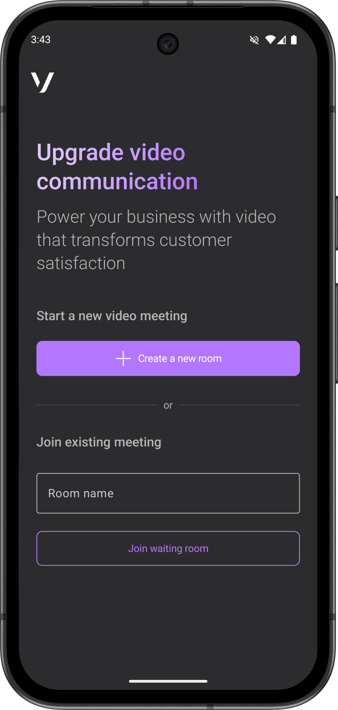
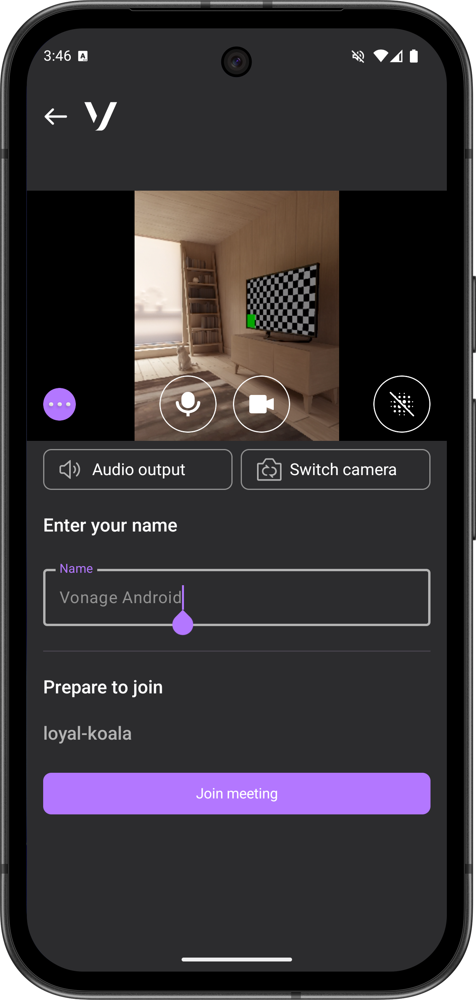
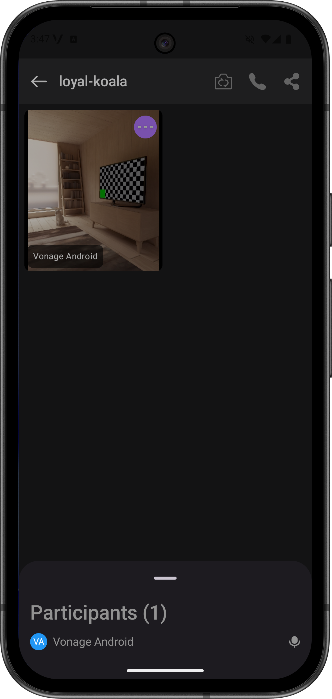
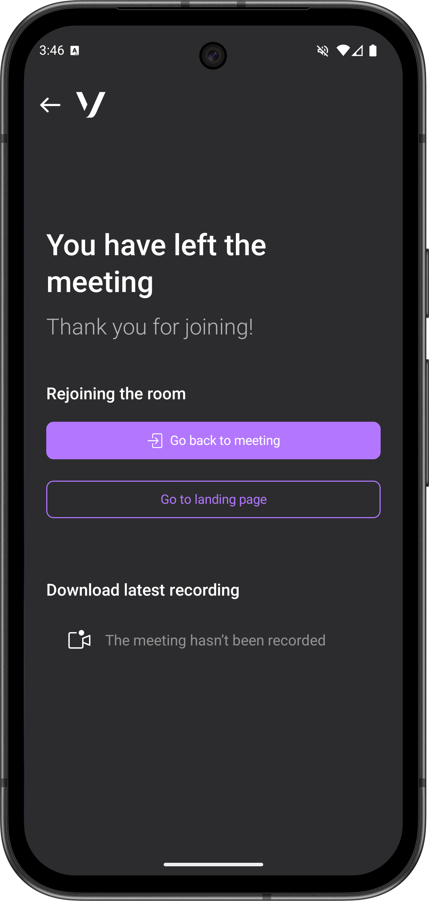

# Vonage Video API Reference App for Android


Open-source video conferencing reference app built on the [Vonage Video API](https://developer.vonage.com/en/video/client-sdks/web/overview) and Android SDK, demonstrating integration patterns from one-to-one calls to multi-participant conferencing with screen sharing, captions, and a foreground service that keeps the call alive in the background.

Also available for [Web (React)](https://github.com/Vonage/vonage-video-react-app) and [iOS](https://github.com/Vonage/vonage-video-ios-app), sharing the same backend. New to Vonage? [Sign up for an API account](https://dashboard.nexmo.com/sign-up?utm_source=DEV_REL&utm_medium=github&utm_campaign=vonage-video-android-app) for free credit.

## Platforms & Requirements

| Requirement | Version |
|---|---|
| Minimum Android version | 7.0 (API 24); 8.0 (API 26) when [Okta authentication](docs/AUTHENTICATION.md) is enabled |
| Compile / target SDK | 37 |
| Architectures | ARM64-v8a, ARMv7, x86, x86_64 |
| Android Studio | A release [compatible with AGP 9.5](https://developer.android.com/build/releases/gradle-plugin#android_gradle_plugin_and_android_studio_compatibility) |
| JDK | 17 or higher |
| Gradle | Provided by the wrapper (`./gradlew`); no separate install needed |

The app runs on phones and tablets. This app has been tested with **Vonage Video SDK 2.32** and **2.33**. Use the latest available SDK version where possible.

## Running Locally

### 1. Deploy the backend

The app requires a running backend. Follow the setup and deployment instructions in the [vonage-video-react-app](https://github.com/Vonage/vonage-video-react-app?tab=readme-ov-file#running-locally) repository. Once the backend is deployed, note its API base URL — you'll need it in step 3.

### 2. Clone the repository

```bash
git clone git@github.com:Vonage/vonage-video-android-app.git
cd vonage-video-android-app
```

### 3. Configure the backend URL

`app-config.json` at the repository root ships with `"baseApiUrl": "${BASE_API_URL}"`. The build resolves `BASE_API_URL` from the first of these sources that is set, and fails with an explicit message if none is:

1. `local.properties` key `BASE_API_URL` (recommended for local development):

   ```properties
   BASE_API_URL=https://your-backend-url.com
   ```

2. Environment variable `BASE_API_URL` (recommended for CI/CD):

   ```bash
   export BASE_API_URL=https://your-backend-url.com
   ```

3. A literal URL in place of the placeholder in `app-config.json`.

> **Emulator tip:** if the backend runs on your machine, use `10.0.2.2` instead of `localhost`. On Android 17 (API 37) and later this also needs the local network permission — see [Permissions](docs/PERMISSIONS.md#local-backend-on-android-17).

### 4. Generate the build configuration

```bash
./gradlew generateVonageConfig
```

This reads `app-config.json` and writes the runtime constants (`AppConfig`) and `gradle/generated-config.properties`, which selects the `enabled`/`disabled` flavor of each optional feature module. Never hand-edit the generated properties file.

### 5. Build and run

Open the project in Android Studio, let Gradle sync finish, and press **Run** (▶). From the command line:

```bash
./gradlew installDebug
```

Debug builds install as `com.vonage.android.debug`, so they can sit next to a release build on the same device.

#### Feature Flags

`app-config.json` also controls which optional features are compiled into the app and which are enabled at runtime. After editing it:

```bash
./gradlew generateVonageConfig
```

Then sync Gradle in Android Studio (or run the next build from the command line). Flavor selection is read when Gradle configures the project, so the new values only take effect on the build that follows regeneration. See [Configuration](docs/CONFIGURATION.md) for the full flag reference and [Authentication](docs/AUTHENTICATION.md) for the Okta setup.

#### UI Customization (Theme)

Colors, typography, and shapes come from `theme.json` at the repository root. After editing it, regenerate the Compose theme:

```bash
./gradlew updateTheme
```

This rewrites the theme sources in `vonage-video-ui-compose/src/main/java/com/vonage/android/compose/theme/`. Commit them with your `theme.json` change, and don't edit them by hand. Theme generation does not run as part of a normal build.

#### Troubleshooting

| Symptom | Fix |
|---|---|
| Build fails with `BASE_API_URL is not configured!` | Set `BASE_API_URL` using one of the options in [step 3](#3-configure-the-backend-url). |
| The emulator can't reach a backend running on your machine | Use `http://10.0.2.2:<port>` instead of `localhost`, and check [Permissions](docs/PERMISSIONS.md#local-backend-on-android-17) on API 37+. |
| A toggled feature doesn't change | Run `./gradlew generateVonageConfig`, then sync Gradle and rebuild. If it still doesn't apply, run `./gradlew clean generateVonageConfig`. |
| Build fails with `Unrecognised top-level key(s) in the app config` | The key isn't known to the generator. See [Adding a new config field](docs/CONFIG-SYSTEM.md#adding-a-new-config-field). |
| Theme edits don't show up | Run `./gradlew updateTheme`; `generateVonageConfig` doesn't regenerate the theme. |

## Features

Vonage Video SDK capabilities this app demonstrates, grouped the same way as the cross-platform [VERA feature matrix](https://api.support.vonage.com/hc/en-us/articles/25623618204444-What-is-the-Vonage-Video-Reference-App). Screenshots are filled in as they become available.

| Category | Feature | Description | Screenshot |
|---|---|---|---|
| Core | Basic Audio/Video | Join a call with camera and microphone enabled, with active speaker detection. | — |
| Core | Mute/Unmute | Toggle the local microphone and camera during a call. | — |
| Core | Screen Sharing | Broadcast your device screen into the call. | — |
| Core | Text Chat | Exchange text messages with other participants during a session. | — |
| Core | Layouts | Switch between active-speaker and grid layouts; the display adapts as participants join, leave, and speak. | — |
| Core | Background Calls | A foreground service keeps the call running when the app is in the background, with a notification to return to it. | — |
| Core | Picture-in-Picture | Keep the call visible in a floating window after leaving the app. | — |
| Pre-Call | Landing Page | Create a new meeting room or join an existing one. |  |
| Pre-Call | Waiting Room | Preview your camera and microphone, choose devices, and set your name before joining. |  |
| Participant Management | Participant List | View everyone in the call with an audio on/off indicator. |  |
| Reactions | Reactions (emoji) | Send and receive emoji reactions during a session. | — |
| Background & Effects | Background Blur | Blur the background behind the local participant in real time. | — |
| Background & Effects | Background Replacement | Replace the background with an image in real time. | — |
| Captions & Accessibility | Live Captions | Real-time speech-to-text captions during the call, with optional per-viewer translation. | — |
| Captions & Accessibility | Post-call Transcription | Start/stop transcription independently of recording; download the transcript after the call. | — |
| Recording | Archiving (Cloud Recording) | Start, stop, and download cloud-based session recordings. | — |
| Audio | Noise Suppression | Reduce background noise from the local microphone during a call. | — |
| Audio | Audio Output Selection | Switch call audio between speaker, earpiece, wired headset, and Bluetooth, and test the speakers. | — |
| Post-Call | Goodbye Page | Return to the landing page, rejoin the room, and download recordings and transcripts. |  |

## Documentation

| Guide | Description |
|---|---|
| [Getting Started](docs/GETTING_STARTED.md) | Step-by-step setup reference: clone, backend URL, build, and run |
| [Configuration](docs/CONFIGURATION.md) | Feature flags, theme customization, base URL, and SDK version |
| [Config System](docs/CONFIG-SYSTEM.md) | Deep-dive into the JSON-driven config plugin system |
| [Authentication](docs/AUTHENTICATION.md) | Optional Okta sign-in, token injection, and identity provider setup |
| [Localization](docs/LOCALIZATION.md) | Multi-language support and how to add a new language |
| [Permissions](docs/PERMISSIONS.md) | Declared permissions, where they come from and why, plus ECH/WebView status |
| [Testing](docs/TESTING.md) | Unit tests, instrumented tests, snapshot tests, and Maestro E2E |
| [Code Style](docs/CODE_STYLE.md) | Detekt, Spotless, and code conventions |
| [Contributing](docs/CONTRIBUTING.md) | How to open issues, submit PRs, and branching conventions |
| [Known Issues](docs/KNOWN_ISSUES.md) | Current known issues and workarounds |

## Getting Help

- Open an issue on this repository
- Tweet at us: [@VonageDev on Twitter](https://twitter.com/VonageDev)
- [Join the Vonage Developer Community Slack](https://developer.vonage.com/community/slack)
- Email support: [support@api.vonage.com](mailto:support@api.vonage.com)

## Further Reading

- Developer documentation: <https://developer.vonage.com>
